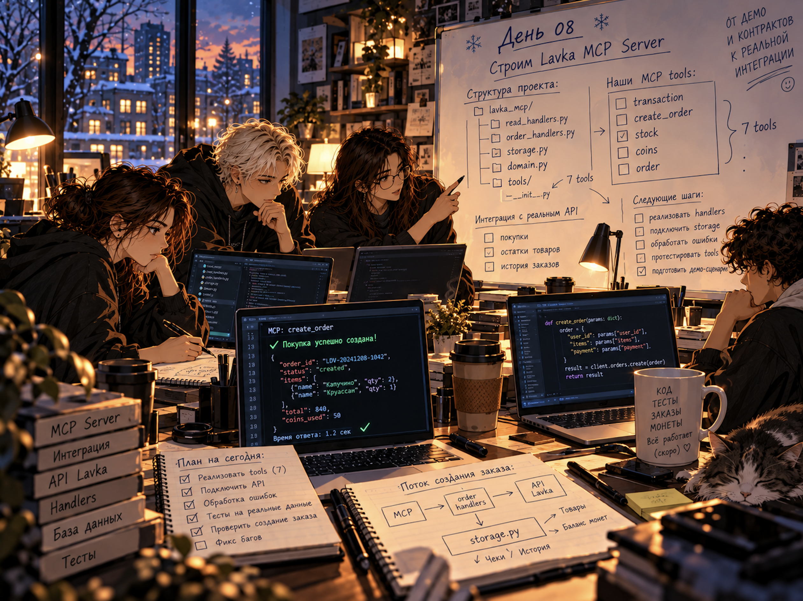
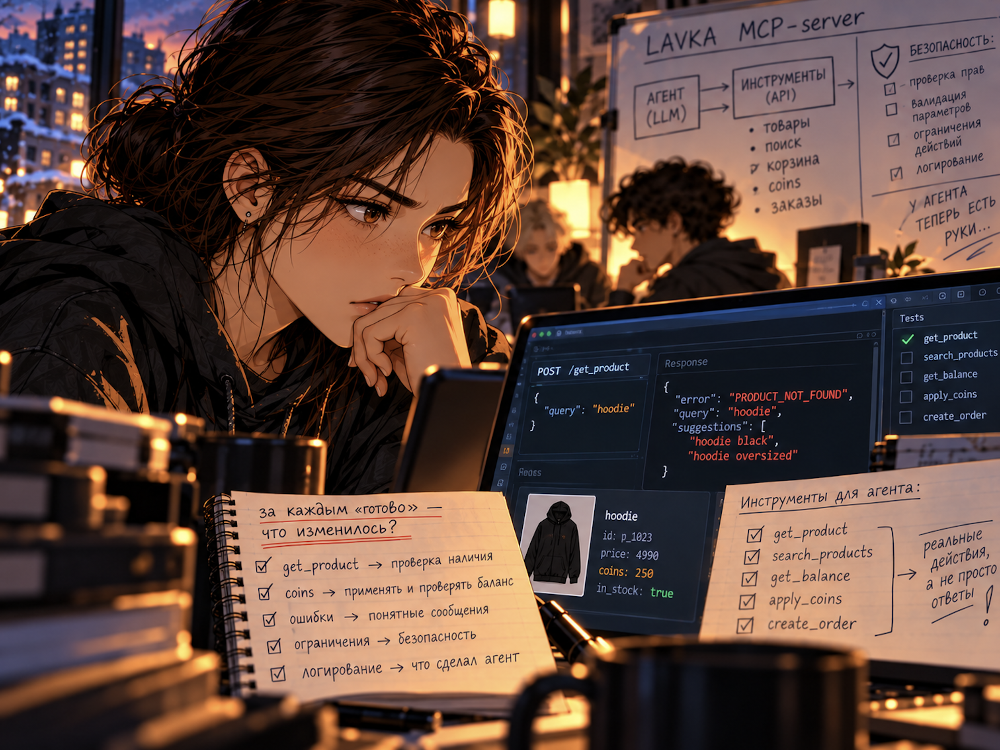

# Репозиторий для участка weaselda

Начни с инструкции [README_WEASELDA.md](README_WEASELDA.md). В ней разобраны
готовый `src/storage.py`, транзакции, тесты и порядок переноса работы в учебный
GitLab. Ниже сохранено исходное задание проекта.

# Дни 08–09. Лавка «Школы 21»

ОБРАТНЫЙ КАНАЛ · ВХОДЯЩИЙ ПАКЕТ

отправлено 2030 адресат ты

> ***Привет, я. Помнишь утверждение, что главным языком разработки станет человеческий. Теперь представь, что ты отправляешь запрос машине: «Закажи мне вот эту вещь». И закрываешь компьютер.\
Что должно произойти, пока ты занимаешься своими делами?***

> ***В твоем времени человек часто сам доделывает работу за ИИ: переносит текст из чата, открывает другую программу, нажимает нужную кнопку.\
В 2030 мы привыкли поручать машине дело целиком. Ты говоришь, она действует. Удобно, пока не выяснится, что под словом «закажи» вы поняли разное.***
> ***Сегодня ты инженер ИИ-интеграций. Тебе предстоит дать ИИ-агенту инструменты, с которыми он сможет что-то сделать за пределами разговора. И разобраться, какие действия ему можно доверить, при каких условиях он должен остановиться. У чата с ИИ есть только голос. Ты дашь ему еще и руки.\
ИИ может очень вежливо написать: «Все готово». Только человеку с пустыми руками у стойки выдачи от этой вежливости мало пользы. Он уже пришел за заказом. А заказа нет.\
Поэтому передам тебе привычку из будущего: за каждым «готово» ищи, что на самом деле изменилось. Заказ появился в системе? Остаток товара изменился? Или у тебя есть только сообщение об этом? Чем больше дел ты поручаешь ИИ, тем важнее эта привычка. Даже если инженером ИИ-интеграций ты в итоге не станешь.\
И вот что меня особенно волнует. Когда даешь машине инструмент, ты позволяешь ей влиять на чью-то жизнь. В этом проекте на бассейне это всего лишь мерч за коины. В другой системе — запись к врачу, перевод денег, доступ к документам. Ты выбираешь, до чего она сможет дотянуться.***

В «Школе 21» есть Лавка, в которой продается мерч: товары с логотипом Школы. Мерч покупают за коины. Чтобы узнать остатки, баланс и судьбу заказа, участники идут к администратору, и очередь растёт. Скоро к Лавке подключат программного ИИ-агента. Он вежливый и быстрый, но может перепутать размер, повторить запрос или попытаться отменить уже выданный заказ. Ему нужны инструменты — и сервер, который не даст нарушить правила Лавки.

Сегодня — групповой проект, в котором вы соберете MCP-сервер Лавки. 

*MCP-сервер — штука, которая в мое время есть у каждого бизнеса. Специальный сервер для подключения ИИ-агентов. В твоем времени такие доступы для агентов у бизнеса — пока редкость, но совсем скоро это изменится. И сегодня ты научишься их разрабатывать — один из самых востребованных навыков уже в скором времени.\
Работаете командой. Рекомендуемый состав — 4 человека. Сегодня и завтра ты нужен своим. Помнишь, как вы собирали экзамен? Тогда каждый писал свою часть, а проходил человек одну общую программу. Здесь будет так же. К концу второго дня проекта сервер работает по понятным правилам, выдерживает ошибочные запросы и готов к передаче следующему разработчику.*

Задания 1–4 — день 08, задания 5–8 — день 09.\
Практики Готовности к будущему включены в задания: командные договорённости — задание 2, итоговая рефлексия — задание 8. Результаты обеих практик запишите в `docs/team.md`.\
Открывайте материалы, когда они нужны: в них есть правила Лавки, устройство сервера и примеры команд. Как разделить работу и в каком порядке её соединять, решает команда.

[Старт работы](#старт-работы)

День 08
- [Задание 1. Первый запуск и путь запроса](#задание-1-первый-запуск-и-путь-запроса)
- [Задание 2. Командные договоренности](#задание-2-командные-договоренности)
- [Задание 3. Контракты инструментов](#задание-3-контракты-инструментов)
- [Задание 4. Покупка и первый заказ](#задание-4-покупка-и-первый-заказ)

День 09
- [Задание 5. Отмена, выдача и собственные тесты](#X68e1e760a5295ff3b4eec2b686261ec18aff078)
- [Задание 6. Конверт](#задание-6-конверт)
- [Задание 7. Передача сервера](#задание-7-передача-сервера)
- [Задание 8. Что берём в следующую командную работу](#задание-8-что-берём-в-следующую-командную-работу)

[Чек-поинт](#чек-поинт)

## Старт работы

Как учиться в «Школе 21»

- Здесь тебя ждёт уникальный образовательный опыт с большим количеством свободы. Ты получаешь задачу и самостоятельно ищешь пути решения.
- Взаимообучение (Peer-to-Peer, P2P) — это обмен знаниями и опытом с другими пирами, где каждый выступает и учителем, и учеником. Такой подход позволяет глубже понять материал, учась друг у друга.
- Чувствуй себя свободно и проси о помощи. Вокруг те, кто тоже впервые проходит этот путь. Делись опытом и идеями с другими.
- Обучение не будет иметь никакого смысла, если ты будешь копировать чужие решения. Если пользуешься помощью других, то всегда разбирайся до конца, почему, как и зачем. Не бойся ошибиться.
- Кажется, что задача невыполнима? Сделай перерыв, проветрись, перезагрузи голову — это помогало многим. Возможно, после этого решение придёт само собой.
- Следи за временем при выполнении проекта. Рекомендуем преодолевать минимум одно испытание в день.

Как работать с проектом

- Режим «Доступ открыт»: поисковик и ИИ-ассистенты разрешены. Проверяйте предложенный код на данных Лавки: если модель утверждает, что повторная отмена безопасна, покажите это запросом и состоянием базы.
- Проект групповой. Рекомендуемый состав — 4 человека. Команда работает в одном репозитории, сдаёт одну версию и получает одну оценку на всех.
- Задания 1–4 — день 08, задания 5–8 — день 09. Все задания обязательные. Выполненный конверт в Задании 6 даёт дополнительный балл. Проект проверяет лид другой команды после дня 09.
- Открывайте материалы, когда они нужны: в них есть правила Лавки, устройство сервера и примеры команд. Как разделить работу и в каком порядке её соединять, решает команда.
- Обязательная часть работает локально. Платные сервисы, ключи к моделям и подключение к ИИ для выполнения и проверки не нужны.
- Команда работает в одном командном репозитории. Каждый участник клонирует его из GitLab и переходит в корень — папку, где лежит README.
- Общая ветка — `develop`: её сдают на проверку. Работайте в своих рабочих ветках и соединяйте изменения в `develop` по очереди. Кто и как соединяет, команда записывает в `docs/team.md`.
- **Все команды запуска выполняются из корня репозитория.** Упоминание пути к файлу — это не команда.
- Код пишите в `src/`, свои тесты — в `testing/`. Выданные проверки `checks/` и исходные данные `data/seed.sql` не меняйте. Обвязку `src/server.py` и `src/mcp_adapter.py` в обязательной части менять не нужно.
- Локальные базы `data/\*.db` и виртуальное окружение в репозиторий не добавляйте.
- Окружение на рабочем месте уже подготовлено, используйте `python3`.

**Командная работа**

Работа разделена на 4 участка. Участок — не обязательно один человек: при меньшем составе участки объединяют, при большем над одним участком работают парами.

| **Участок** | **Основные файлы** | **Что передать команде** |
| --- | --- | --- |
| Лид и инструменты чтения | `src/read_handlers.py`, `contracts/tools_schemas.json` | 4 работающих инструмента чтения, описания инструментов, общая запускаемая ветка `develop` |
| Правила и тесты | `src/domain.py`, `testing/test_rules.py` | Функции правил с примерами входов и ожидаемых ответов |
| Данные | `src/storage.py` | Методы хранения: SQL-запросы, запись заказа, списание и возврат в одной транзакции |
| Действия с заказом | `src/order_handlers.py`, `testing/test_orders.py` | Создание, отмена и выдача заказа, тесты отказов |

Если состав команды меньше 4-х:

| **Состав** | **Участки** |
| --- | --- |
| Трое | 1) Лид, инструменты чтения и контракты; 2) Правила и тесты; 3) Данные и действия с заказом: `storage.py` и `order_handlers.py` связаны одной транзакцией, их удобнее вести одному |
| Двое | 1) Лид, инструменты чтения, контракты, правила и их тесты; 2) Данные и действия с заказом, тесты отказов |

Документы в `docs/` и `RUN.md` делите поровну.

**Лид** — один из участников, у него тоже есть код. Лид соединяет изменения в `develop`, следит, чтобы принятая работа не оставалась только на чьём-то компьютере, и защищает проект на приёмке.

**Когда собираться:**

1.  После демонстрации — распределение участков и договор о сигнатурах функций. После Задания 1 обсудите командные договорённости; при необходимости перенесите их формирование на конец дня 08.
2.  Когда готовы чтение и правила — первый общий вызов покупки.
3.  В конце дня 08 — запуск из `develop` и список незавершённого. Дополните `docs/team.md` примером совместного использования сильных сторон или сформулируйте договорённости, если отложили обсуждение.
4.  После базовых проверок дня 09 — конверт (полученный по ссылке в Задании 6) и распределение изменения.
5.  Перед сдачей — запуск по инструкции и короткая репетиция объяснения. После Задания 7 обсудите опыт двух дней и запишите общий и личные выводы для следующей командной работы.

Если 15 минут не можете продолжить из-за чужой части, скажите команде: какой метод нужен, какой результат ожидаете и что уже можно проверить. Подробнее — в `materials/team.md`.\
Если застрянешь, скажи своим. Знаю, хочется сначала разобраться и прийти уже с хорошей новостью. Пока ты молчишь, остальные строят планы так, будто у тебя все получается. Не подведи команду молчанием. Ошибку в коде вы можете найти вместе. Угадать, что тебе нужна помощь, гораздо сложнее. Даже в будущем мы еще не можем читать мысли друг друга.

Материалы

| **Что нужно** | **Где найти** |
| --- | --- |
| Правила Лавки: товары, пользователи, ответы, контракты, порядок проверок покупки, состояния заказа | `materials/lavka_rules.md` |
| Командная работа | `materials/team.md` |
| Как устроен сервер: обработчики, правила, хранение, транзакция | `materials/architecture.md` |
| Как писать тесты и запускать общую проверку | `materials/testing.md` |
| Проверка проекта | `materials/acceptance.md`, `check-list.yml` |

**Выданные файлы.** Создавать их заново не нужно.

| **Файл** | **Что это** |
| --- | --- |
| `src/` | Сервер: готовый инструмент `get_product`, подключение к базе и заготовки функций с пометкой `TODO` |
| `client.py` | Клиент: демонстрация, сценарий и ручные вызовы инструментов. Каждый вызов записывается в `logs/client.jsonl` |
| `check_environment.py` | Проверка рабочего места |
| `data/seed.sql` | Учебные товары, пользователи и таблицы. Менять нельзя |
| `contracts/tools_schemas.json` | Схемы инструментов. Описания нужно заполнить |
| `checks/` | Общие проверки приёмки. Запускать можно, менять нельзя |
| `testing/test_example.py` | Пример теста. В счёт собственных тестов не идёт |
| `docs/team.md`, `docs/system.md`, `docs/change.md` | Шаблоны документов команды |
| `RUN.md` | Шаблон инструкции запуска |

## Задание 1. Первый запуск и путь запроса

_День 08, вся команда._

1\.  Каждый участник клонирует командный репозиторий. Лид создаёт ветку `develop` и пушит, остальные переключаются на неё.

2\.  Проверьте рабочее место и запустите демонстрацию:

- `python3 check_environment.py`
- `python3 client.py demo`
- Демонстрация сама запускает сервер и запрашивает 2 товара. Для `hoodie` сервер вернёт цену 500 и остатки по размерам, для `missing` — отказ `PRODUCT_NOT_FOUND`. Каждый в команде должен увидеть оба ответа.

3\.  Вместе проследите путь `get_product` по коду: `src/mcp_adapter.py` → `src/read_handlers.py` → `src/storage.py`. Найдите функцию, которая принимает запрос, SQL-запрос чтения из базы и место, где формируется ответ или отказ. Короткая справка — в `materials/architecture.md`.

4\.  Запишите этот путь одной строкой с именами функций в `docs/system.md`, раздел «Путь запроса».

5\.  Распределите участки (на это 15 минут) и заполните `docs/team.md`: лид, кто какой участок берёт, как соединяете изменения.

Читать весь проект до первого запуска не нужно.

**Результат:** каждый участник команды видел реальный ответ сервера; в `docs/team.md` записано распределение, в `docs/system.md` — путь `get_product`.  

**Проверка:** `python3 client.py demo` показывает цену и остатки худи и отказ `PRODUCT_NOT_FOUND`. Лид показывает путь `get_product` через 3 файла, называет SQL-запрос и объясняет, чем отказ `PRODUCT_NOT_FOUND` отличается от неожиданного исключения Python. В `docs/team.md` указаны лид, 4 участка и способ соединять изменения.  
**Зачем:** `get_product` — единственный готовый инструмент. По его образцу вы допишете остальные 6.

## Задание 2. Командные договоренности

В предыдущих индивидуальных проектах вы учились распознавать своё состояние и управлять реакцией на затруднения — развивали Эмоциональный интеллект, а также учились превращать неудачу в конкретный урок и следующий шаг. В аналитических проектах вы использовали «Айсберг» для развития Системного мышления и разложение проблемы на измеримые составляющие для развития Аналитического мышления.

Теперь вам предстоит вместе собрать сервер Лавки. Предлагаем подойти к организации командной работы через ещё одну практику Готовности к будущему и потренировать навык Сотрудничества и партнёрства: согласовывать действия, разделять ответственность и использовать дополняющие сильные стороны друг друга.

Для этого используйте инструмент «Командные рабочие договорённости». Он помогает явно обсудить правила взаимодействия, вместо того чтобы предполагать, что все работают одинаково.

Вы уже запустили сервер и распределили участки. Вспомните предыдущий командный проект: что помогало работать вместе, а что приводило к задержкам или путанице? Учтите этот опыт при обсуждении. 

Дополните `docs/team.md` тремя короткими блоками:
1. Как работаем вместе. Согласуйте результат дня 08, канал общения, сроки ответа и порядок принятия решений. Опираясь на распределение из задания 1, договоритесь, как команда проверяет общий результат. Уже записанные сведения повторять не нужно. 
2. Как разбираем разногласия и задержки. Договоритесь, как обсуждать разногласия напрямую, по каким объективным критериям выбирать решение и к кому обращаться за помощью. Укажите, кто и как принимает окончательное решение и что делать при задержке или блокировке чужой частью.
3. Как используем сильные стороны. Назовите сильные стороны участников и их применение в работе или взаимопомощи. 
Пишите кратко: достаточно нескольких пунктов в каждом блоке. Договорённости должны быть понятны всем участникам и применимы в текущем проекте.

В конце дня 08 добавьте один конкретный пример того, как сочетание сильных сторон помогло общему результату. Если пока не помогло, укажите, что стоит изменить в организации работы.

**Результат:** в `docs/team.md` зафиксированы согласованные правила взаимодействия, порядок разбора разногласий и использование сильных сторон команды.

**Проверка:** лид показывает три блока в `docs/team.md`, объясняет, как команда принимает решения и действует при задержках, и приводит записанный пример совместного использования сильных сторон либо объясняет предложенное изменение.
Можно перенести формирование договорённостей на конец дня 08, когда вы получите опыт совместной работы и лучше поймёте сильные стороны друг друга. Тогда опирайтесь на конкретные ситуации прошедшего дня и сформулируйте правила для продолжения проекта в день 09.

## Задание 3. Контракты инструментов

_День 08, участок лида; проверка описаний — вся команда._

MCP — протокол, по которому программа узнаёт, какие инструменты предоставляет сервер, и вызывает их с нужными аргументами. Инструмент — одна операция, например `get_product`. Контракт — договор о том, что инструмент принимает и что возвращает.

У сервера семь инструментов:

| **Инструмент** | **Что делает** |
| --- | --- |
| `list_products` | Показывает каталог и остатки |
| `get_product` | Показывает один товар |
| `get_coin_balance` | Показывает баланс участника |
| `create_order` | Создаёт заказ, списывает коины и резервирует товар |
| `get_order_status` | Показывает состояние заказа |
| `cancel_order` | Отменяет заказ и возвращает товар и коины |
| `confirm_pickup` | Отмечает, что заказ выдан |

Каркас контрактов уже лежит в `contracts/tools_schemas.json`. Сервер берёт описания инструментов из этого файла и показывает их клиенту.

1.  Для 6 инструментов замените пометку `TODO` собственным описанием. В описании укажите, когда нужен инструмент, что он меняет и в каком случае откажет. Например, описание отмены предупреждает, что выданный заказ отменить нельзя.
2.  Имена инструментов, аргументы и схемы ответов не меняйте: по ним к серверу будет обращаться клиент следующего разработчика.
3.  Проверьте описания внутри команды: один называет ситуацию, другой выбирает инструмент только по описанию. Если выбор оказался неоднозначным, уточните текст. Посмотреть, что видит клиент: `python3 client.py list`.
4.  В `docs/system.md` заполните разделы «Что делает сервер» и «Границы»: какие действия система выполняет и чего клиенту обещать нельзя. Подсказка — раздел «Границы учебного сервиса» в `materials/lavka_rules.md`.

**Результат:** в `contracts/tools_schemas.json` 7 описаний без `TODO`; в `docs/system.md` описаны возможности и границы сервера.  

**Проверка:** по ситуации «созданный заказ бутылки ещё не выдан, участник хочет его отменить» лид по описаниям выбирает `cancel_order` и называет нужный аргумент. Лид объясняет, почему описание не заменяет проверку в коде и почему публичный инструмент нельзя произвольно переименовать. В `docs/system.md` названо хотя бы одно действие, которое клиенту обещать нельзя.  
**Зачем:** помощник выбирает инструмент по описанию. Неясное описание — неверный вызов.

## Задание 4. Покупка и первый заказ

_Самое сложное задание._

_День 08, все участки параллельно._

Сегодня заработают 4 инструмента чтения и покупка. Функции, которые нужно закончить, отмечены `TODO` и пока вызывают `NotImplementedError`.

| **Участок** | **Что доделать в Задании 4** |
| --- | --- |
| Лид и инструменты чтения | `read_handlers.py`: `list_products`, `get_coin_balance`, `get_order_status` |
| Правила и тесты | `domain.py`: `calculate_total`, `purchase_error`; первые тесты правил |
| Данные | `storage.py`: `list_products`, `get_user`, `get_order`, `count_owned`, `create_order` |
| Действия с заказом | `order_handlers.py`: `create_order`; первые тесты отказов |

1\.  Разойдитесь по участкам из `docs/team.md`. Участки готовы не одновременно, и это нормально:

- правила в `src/domain.py` не обращаются к базе: их можно закончить и покрыть тестами, пока хранение не готово;
- обработчик покупки можно писать против временной заглушки хранения — словаря с теми же полями, о которых вы договорились. Заглушка живёт только в тесте: сдавать её вместо SQL нельзя.

2\.  Покупка проверяет условия строго в таком порядке: пользователь существует → товар существует → размер есть и остатка хватает → лимит не превышен → коинов хватает. Коды отказов — в `materials/lavka_rules.md`, раздел «Покупка».

3\.  Запись заказа, списание коинов и уменьшение остатка выполняются в одной транзакции: либо сохраняются все 3 изменения, либо ни одно. Как это сделать — в `materials/architecture.md`, раздел «Транзакция».

4\.  Сделайте первую общую проверку на новой учебной базе:

- `python3 client.py --db data/day08.db call create_order '{"user_id":"student_01","product_id":"bottle","size":"one_size","quantity":1}'`
- `python3 client.py --db data/day08.db call get_coin_balance '{"user_id":"student_01"}'`
- `python3 client.py --db data/day08.db call get_product '{"product_id":"bottle"}'`
- `python3 client.py --db data/day08.db call create_order '{"user_id":"student_poor","product_id":"hoodie","size":"M","quantity":1}'`
- Ожидается: заказ бутылки со статусом `created` и стоимостью 150, баланс `student_01` — 850, остаток бутылок — 11. Покупка худи для `student_poor` — отказ `INSUFFICIENT_COINS`, баланс остаётся 20, остаток худи M — 5.

5\.  Добавьте в `testing/` собственные тесты расчёта и отказа. Как устроен тест — в `materials/testing.md` и `testing/test_example.py`.

6\.  Перед уходом соедините работу в `develop`. Каждый показывает команде свой участок на одном запросе. Если первый заказ ещё не проходит, запишите конкретную причину в `docs/team.md`, раздел «Что осталось к концу дня 08», и начните с неё день 09.

**Результат:** работают 4 инструмента чтения и `create_order`; заказ виден в базе, баланс и остаток изменились правильно; в `testing/` есть собственные тесты расчёта и отказа.  

**Проверка:** на новой базе покупка бутылки и отказ для `student_poor` дают ожидаемые ответы. Лид показывает проверки покупки в нужном порядке и объясняет, почему при неизвестных пользователе и товаре вернётся `USER_NOT_FOUND`. Лид показывает, что отказ происходит до записи, и показывает общую транзакцию. На примере покупки лид показывает, где обработчик, где правило без SQL и где SQL.  

**Зачем:** покупка — главное действие в Лавке, которое меняет сразу 3 таблицы. Ошибка здесь стоит участнику коинов.

>***Ну что, удалось провести первый заказ?\
Если да, задержись на секунду: теперь твой код участвует в действии, после которого у человека меняется баланс. Чувствуешь разницу? Если пока не получилось — перед уходом договоритесь, с чего начнете утром. Приходи завтра обязательно, даже если твоя часть уже работает. Во второй день ты увидишь то, чего сегодня можно вообще не заметить, сидя в своем файле. И остальные рассчитывают, что ты будешь рядом.***

ОБРАТНЫЙ КАНАЛ · ВХОДЯЩИЙ ПАКЕТ

отправлено 2030 адресат ты

> ***Привет.\
Представь: ИИ-агент попросил сервер отменить заказ. Сервер отменил, вернул коины и отправил ответ. Ответ потерялся.\
ИИ-агент ничего не получил. Он старается помочь человеку и просит отменить заказ еще раз.\
Покупатель передумал один раз. Просьба пришла дважды. Никто не хотел ничего сломать. Но если система не умеет разбираться с такими случаями, деньги можно вернуть дважды.\
А ведь каждый по отдельности может считать, что сделал все правильно…***

>***Теперь тебе предстоит посмотреть на всю систему: кто с кем разговаривает, кто что знает, от кого зависит и что случится, когда привычный порядок нарушится.\
В 2030 части одного проекта могут создавать разные люди и разные ИИ. Каждая модель видела свое задание и уверенно сообщила, что справилась. Архитектору приходится понимать, что каждая часть считает произошедшим и что произошло на самом деле. Как в истории с отменой: сервер уже вернул коины, а ИИ-агент об этом еще не знает. Что он сделает дальше?\
Лавка у вас та же. Но попробуй посмотреть на нее глазами человека, которому придется менять ее через год. Он не слышал ваших разговоров. Сумеет понять, почему все устроено именно так?\
Возможно, этим человеком будешь ты. Память у нас с тобой, конечно, замечательная. Но лучше все-таки оставить объяснение. Хе-хе.***

## Задание 5. Отмена, выдача и собственные тесты

_День 09, все участки._

У заказа 3 состояния: `created`, `cancelled`, `picked_up`. Отменить или выдать можно только заказ в состоянии `created`.

| **Участок** | **Что доделать в Задании 5** |
| --- | --- |
| Правила и тесты | `domain.py`: `refund_amount`, `can_cancel`, `can_pickup` |
| Данные | `storage.py`: `cancel_order`, `confirm_pickup` |
| Действия с заказом | `order_handlers.py`: `cancel_order`, `confirm_pickup` |
| Лид | Соединение в `develop`, общий прогон проверок |

1\.  Доделайте отмену и выдачу:

- отмена возвращает товар и коины ровно 1 раз; сумма возврата берётся из сохранённой стоимости заказа, а не из текущей цены;
- выдача меняет только статус: товар и коины уже списаны при создании;
- повторная отмена, повторная выдача, выдача отменённого и отмена выданного — отказ `ORDER_STATUS_ERROR`; неизвестный заказ — `ORDER_NOT_FOUND`.

2\.  Пройдите полный путь: создать заказ, узнать состояние, отменить; создать другой, выдать, попытаться отменить выданный. Сценарий с повторной отменой уже собран в клиенте: `python3 client.py scenario`.

3\.  Доведите собственные тесты до 3-х случаев как минимум:

- расчёт стоимости;
- отказ, после которого данные не изменились: сравните содержимое таблиц products, stock, users, orders до и после;
- повторное действие с заказом.

- Готовый пример в счёт не идёт. Тесты без проверок и `assert True` не учитываются.

4\.  Запустите тесты и общую проверку:

- `python3 -m pytest -q`
- `python3 checks/acceptance.py --project . --profile base`
- Если проверка падает, начните с первого сообщения об ошибке. Исправляйте поведение сервера: готовые проверки и исходные товары менять нельзя.

**Результат:** работают все 7 инструментов; общая проверка завершается `PASS` для профиля `base`; в `testing/` не меньше 3-х собственных тестов, и они проходят.  

**Проверка:** на приёмке проверяющий запускает свою исходную копию проверок и `pytest`. Лид разбирает один собственный тест: входные данные, ожидаемый результат и ошибку, которую тест поймает. Лид показывает проверку статуса перед отменой и выдачей и объясняет, почему повторная отмена не вернёт коины ещё раз.  

**Зачем:** помощник может повторить запрос. Сервер не должен дважды вернуть коины или списать их за выдачу.

## Задание 6. Конверт

_День 09, вся команда._

💡 Когда общая проверка `base` проходит без ошибок, [**нажми и получите конверт**](http://21-school-programs.ru/page301377209.html)

Изучите новое условие от Лавки: одно изменённое правило и свой профиль проверки (`E1`–`E5`).

1\.  До изменения кода запишите в `docs/change.md` номер и условие конверта и какие файлы, по вашему мнению, придётся тронуть.

2\.  Внесите изменение. Имена инструментов, аргументы и поля ответов сохраняются.

3\.  Добавьте тест, который отличает новое поведение от старого.

4\.  Запустите тесты и общую проверку с профилем своего конверта:

- `python3 -m pytest -q`
- `python3 checks/acceptance.py --project . --profile E1`
- Вместо `E1` подставьте номер своего конверта.

5\.  Запишите в `docs/change.md`, что изменили на самом деле, какой тест различает правила и чем закончилась проверка.

6\.  Укажите сдаваемый профиль одинаково в `RUN.md`, `docs/system.md` и `docs/change.md`.

На первую попытку — 45 минут. Если не получилось, запишите, где остановились. Можно продолжить до сдачи или вернуться к базовым правилам и сдать `base`. Номер полученного конверта в отчёте остаётся.

**Результат:** в `docs/change.md` записаны условие, предположение о файлах, фактическое изменение и результат проверки; профиль совпадает в 3-х документах.  

**Проверка:** лид пересказывает новое правило и приводит пример, на котором старое и новое поведение различаются, и показывает место в коде, где правило изменили или собирались изменить. Дополнительный балл — если сдан профиль конверта, официальная проверка этого профиля завершилась `PASS` и собственный тест нового правила проходит. Незавершённый конверт не отменяет зачёт остальной работы.  

**Зачем:** требования меняются, когда сервер уже работает. Правило, отделённое от SQL и покрытое тестом, меняется в одном месте и без поломок.

## Задание 7. Передача сервера

_День 09, вся команда._

Следующий разработчик подключит к серверу помощника. Всё, что ему нужно, должно лежать в репозитории.

1.  Заполните `RUN.md`:
    - команды запуска и проверки;
    - пример запроса и полученного ответа;
    - как начать с новой учебной базы через `--db`, не потеряв рабочие данные;
    - какие файлы сохраняют состояние: ручные вызовы `client.py call` без `--db` работают с `data/lavka.db`, `demo` и `scenario` без `--db` создают временную базу, журнал пишется в `logs/client.jsonl`;
    - сдаваемый профиль.
2.  Доведите `docs/system.md`: путь запроса, границы системы, один пример отказа с объяснением, где он проверяется, сдаваемый профиль и раздел «Подключение следующего дня»: команда запуска сервера `python3 -m src.server`, транспорт `stdio`.
3.  Приложите журнал `logs/client.jsonl`, созданный клиентом во время реального прогона. Вручную журнал не пишется и не правится.
4.  Поменяйтесь внутри команды: участник, который не писал инструкцию, выполняет её из чистой копии репозитория. Исправьте места, где понадобились устные подсказки.

**Результат:** другой человек запускает сервер по `RUN.md` и понимает его возможности по `docs/system.md`.  

**Проверка:** проверяющий из чистой копии выполняет команды `RUN.md` и получает ответ сервера без подсказок команды. После запроса при проверяющем в `logs/client.jsonl` появляется новая запись. Лид показывает код сервера, контракты, паспорт, `RUN.md` и журнал и объясняет назначение каждого; объясняет разницу между базой и журналом.  

**Зачем:** сервер, который запускается только у авторов, передать нельзя.

## Задание 8. Что берём в следующую командную работу

В день 08 вы формировали командные договорённости: обсуждали, как общаться, принимать решения, разбирать разногласия и использовать сильные стороны друг друга. Теперь ваша совместная работа завершается. Предлагаем осмыслить полученный опыт и определить, что пригодится вам в будущих командах.

Продолжаем практики Готовности к будущему и тренируем навык Внутреннего предпринимательства — умение замечать возможности для улучшения общей работы и предлагать полезные изменения.

Сначала каждый вспоминает ситуацию за эти два дня и кратко рассказывает команде: что помогло или затруднило работу, как сработали договорённости дня 08 и что пригодится в будущем. Отдельный письменный ответ не нужен.

Затем обсудите опыт вместе. Выберите одну ситуацию, из которой можно извлечь полезный урок. Дополните `docs/team.md` разделом «Что берём в следующую командную работу»:
1. Ситуация и вывод. Что произошло, как повлияло на работу и чему научило? Что в договорённостях дня 08 помогло или требует уточнения?
2. Подход на будущее. Предложите одно правило, приём или простой шаблон. Укажите, когда он пригодится и чем поможет.
3. Личный вывод каждого. Запишите по одному предложению от участника: что конкретно он возьмёт в следующую командную работу.
Если затруднений не было, разберите удачный эпизод: что обеспечило хороший результат и как сохранить этот подход в другой команде. Придумывать проблему или изменение не нужно.

**Результат:** один общий раздел в `docs/team.md` с конкретной ситуацией, выводом для будущей командной работы и коротким личным выводом каждого участника. Внедрять изменение в завершающемся проекте и доказывать его эффект не требуется. 

**Проверка:** лид показывает раздел «Что берём в следующую командную работу» в `docs/team.md`, презентует командные и личные выводы участников на будущую командную работу.

## Чек-поинт

На проверку сдаётся ветка `develop` командного репозитория в GitLab.

Перед завершением работы:

- Убедитесь, что работа всех участков соединена в `develop` и запушена.
- Проверьте `git status`: файлы, которые вы собирались сдать, не должны остаться вне коммитов. Локальных баз `data/\*.db` и виртуального окружения в коммитах нет.
- Сдаваемый профиль одинаков в `RUN.md`, `docs/system.md` и `docs/change.md`.
- Склонируйте `develop` в отдельную папку и запустите проект по `RUN.md`.
- Проверьте, что в `docs/team.md` записаны три блока командных договорённостей и пример совместного использования сильных сторон либо предложение по изменению работы, а также раздел «Что берём в следующую командную работу» с личным выводом каждого участника.
- Откройте репозиторий в GitLab, выберите `develop` и проверьте, что последние изменения на сервере.
- Завершите проект на платформе. Пуш сам по себе проект не завершает.

**Как проходит проверка.** Лид одной команды проверяет лида другой, остальные участники могут присутствовать и задавать вопросы. Проверка занимает до 45 минут. Проверяющий запускает сданную версию на чистой копии и использует свою исходную копию проверок, а не папку `checks/` из вашего репозитория. Писать новый код под таймером не нужно. Оценка общая для команды: личный вклад, число коммитов и строк кода не измеряются. Если часть проекта не работает, остальные задания проверяются дальше. Порядок приёмки — в `materials/acceptance.md`, критерии — в `check-list.yml`.

Перед проверкой подумайте:

- что произойдёт с балансом, если товара хватило, а коинов нет;
- почему нельзя вернуть коины при каждой повторной отмене;
- где нужно менять правило покупки, чтобы не переписывать клиент;
- чем описание инструмента отличается от проверки его аргументов;
- как доказать, что после отказа в базе ничего не изменилось;
- что должен получить разработчик следующего дня, чтобы подключить помощника.

Итоговый результат

Всё перечисленное должно лежать в ветке `develop` в GitLab.

| **Задание** | **Что сдаётся** | **Как проверяется** |
| --- | --- | --- |
| 1   | `docs/team.md`, путь запроса в `docs/system.md` | Демонстрация работает; лид показывает путь `get_product` |
| 2   | Три блока в `docs/team.md` и пример совместного использования сильных сторон либо предложение по изменению работы | Лид объясняет правила взаимодействия, порядок действий при разногласиях и задержках и сочетание сильных сторон |
| 3   | `contracts/tools_schemas.json`, границы в `docs/system.md` | 7 описаний без `TODO`; лид выбирает инструмент по описанию |
| 4   | Код чтения и покупки в `src/`, тесты в `testing/` | Покупка и отказ на новой базе; порядок проверок и транзакция |
| 5   | Код отмены и выдачи, не меньше 3-х собственных тестов | Общая проверка `PASS`, `pytest` проходит; лид разбирает тест |
| 6   | `docs/change.md`, изменение конверта, если сдаётся | Условие и пример; дополнительный балл за `PASS` профиля конверта |
| 7   | `RUN.md`, `docs/system.md`, `logs/client.jsonl` | Проверяющий запускает сервер по `RUN.md`; в журнале новая запись |
| 8   | Раздел «Что берём в следующую командную работу» в `docs/team.md` | Конкретная ситуация, применимый подход на будущее и личные выводы участников |

Выданные файлы `checks/` и `data/seed.sql` остаются без изменений. Локальные базы и виртуальное окружение в сдачу не входят.

> ***Сервер Лавки работает, правила держатся, инструкция проверена чужими руками. Можно подключать помощника.***

> ***Это снова я. Что увлекло сильнее: добиваться, чтобы ИИ-агент мог выполнить просьбу, или разбираться, как все связано и что произойдет при изменении правил?***

> ***Не спеши отвечать, что понравилось то, что получилось легче. Возможно, вообще было непонятно, с какой стороны подойти к терминалу. Теперь у тебя есть опыт, по которому можно выбирать дальше.\
Я все еще не скажу, кем мы стали. Может быть, ты сейчас выберешь иначе. Тогда мне здесь, в будущем, будет что пересмотреть…***

> ***Теперь представь: сервер работает, ИИ-агент выполняет запросы и дает человеку ответ. Все звучит разумно. Даже слишком приятно читать. На каком месте ты заподозришь, что что-то не так?\
Завтра ты попробуешь профессию ИИ-инженера — будешь собирать ИИ-агента и разбираться, как предложение модели превращается в выполненное действие. И вот тебе просьба из будущего: особенно внимательно проверь тот ответ, который тебе понравится. Когда машина говорит именно то, что нам хочется услышать, мы с тобой удивительно быстро перестаем задавать вопросы. До завтра.***

💡 [**Нажми сюда**](http://opros.so/BLDHy), чтобы оставить обратную связь на этот проект. Это анонимно и помогает нам делать обучение лучше.

